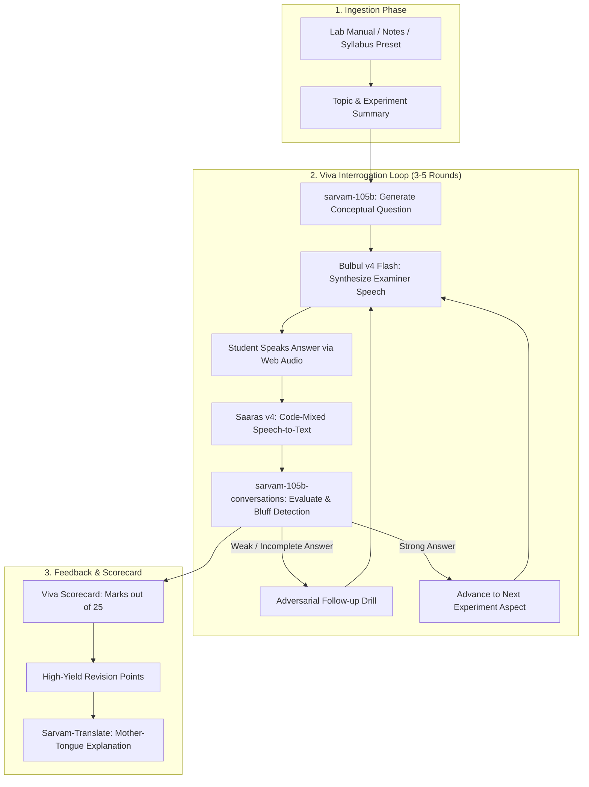

# 🏛️ VivaPrep AI — AI External Examiner for Practical Vivas
### Project Plan & Technical Specification

> **Live Production Application**: [https://viva-voce-ai.onrender.com/](https://viva-voce-ai.onrender.com/)  
> **GitHub Repository**: [https://github.com/ard714/viva-voce-ai](https://github.com/ard714/viva-voce-ai)  
> **Mission**: Build an AI-powered adversarial oral examiner that helps Indian college students prepare for practical and laboratory viva exams by testing spoken understanding, probing weak answers, and handling code-mixed (Hinglish/regional) speech.

---

## 1. Problem Statement & Opportunity

### The Indian Academic Viva Problem
In Indian universities (VTU, AKTU, Anna University, Mumbai University, polytechnics, pharmacy, and medical colleges):
- **Up to 40% of practical marks** come from the viva voce conducted by an external examiner.
- Students practice by silently memorizing formulas, definitions, and theory notes.
- When facing an examiner, students **freeze** or stammer when translating technical concepts into spoken English.
- Students naturally explain concepts in **code-mixed Hinglish / Tanglish** (e.g., *"Sir, jab frequency increase karte hain, reactance decrease hoti hai"*). Most interview prep software marks this as gibberish.
- **Examiners are adversarial**: They detect when a student is bluffing, ask "why" follow-ups, and interrupt memorized rote answers.

### Why Existing Tools Fail
- **Job interview bots (LeetCode / STAR behavioral)** focus on corporate HR questions, not physics derivations, circuit laws, chemical titrations, or pharmacology mechanisms.
- Standard ASR models (Whisper/Google) struggle with heavy Indian regional accents and code-mixed technical jargon.
- Sarvam AI's Indic models provide an unfair advantage in solving this exact problem.

---

## 2. Sarvam AI API & Model Architecture

### Exact Model Specifications

| Component | Sarvam Model ID | Modality | Role |
| :--- | :--- | :--- | :--- |
| **Examiner Logic & Grading** | `sarvam-105b` | Text → Text | Deep reasoning, fact-checking against syllabus notes, detecting student bluffing. |
| **Conversational Flow** | `sarvam-105b-conversations` | Text → Text | Real-time, responsive multi-turn dialogue with low latency. |
| **Examiner Voice** | `bulbul:v4-flash` | Text → Audio | High-speed, natural prosody with realistic Indian English and Hindi-accented teacher voices (`ratan_hi_documentary`, `shreya`, `kabir`). |
| **Student Speech-to-Text** | `saaras:v4` | Audio → Text | 23-language ASR with `mode="codemix"` to accurately transcribe Hinglish, Tanglish, etc. |
| **Regional Explanations** | `sarvam-translate:v1` | Text → Text | Translates complex feedback and model answers into student's home language (22 Indian languages). |

---

## 3. Product Features & User Experience

### A. Examiner Personas
- **Prof. R.K. Sharma (The Strict External)**:
  - Highly critical, demands precise units, cuts off rambling, asks *"Don't recite book lines, explain the physical intuition."*
- **Dr. Ananya Sen (The Supportive Guide)**:
  - Patient, gives hints when the student freezes, asks guided step-by-step questions.
- **Dr. Kabir Rao (The Rapid-Fire Formula Grill)**:
  - Fast-paced 15-second timer per question testing constants, pin diagrams, and unit conversions.

### B. The Viva Interaction Loop
1. **Prompt**: The examiner speaks a targeted question aloud via audio.
2. **Response**: Student speaks into the microphone (hands-free VAD or push-to-talk).
3. **Transcription**: Saaras v4 transcribes code-mixed speech, preserving technical keywords.
4. **Adversarial Follow-Up**: If an answer is vague, the examiner immediately challenges it:
   - *"You mentioned reactance decreases, but what happens at resonance? What is the impedance then?"*

### C. The Comprehensive Viva Scorecard
- **Viva Grade**: Scored on the official Indian practical scale (e.g. `/25` marks).
- **Bluff Meter**: Highlights answers where buzzwords were used without explaining underlying principles.
- **Caught Out Points**: Specific concepts where the external examiner would have deducted marks.
- **Cheat Sheet**: 3 bullet-point model answers for missed questions.
- **Regional Translation**: One-click feedback translation into Hindi, Tamil, Telugu, Marathi, Bengali, etc.

---

## 4. Technical Stack

- **Backend**: Python 3.13 + FastAPI + Uvicorn.
  - SDK: `sarvamai` (Chat, Speech-to-Text, Text-to-Speech, Translation).
  - Environment: Managed through `.env` (`SARVAM_API_KEY`).
  - Session Store: In-memory dictionary / session cache.
- **Frontend**: Clean Vanilla HTML5 / Modern CSS / Vanilla JavaScript.
  - Audio capture: Native `MediaRecorder` API (recording in 16kHz WebM).
  - Audio playback: Native HTML5 Audio element.
  - Glassmorphic, dark-mode academic terminal theme.
- **Deployment**: Live on Render (`https://viva-voce-ai.onrender.com/`).

---

## 5. Development Roadmap & Milestones

### Phase 1: MVP Core Voice Loop — [x] COMPLETED & SHIPPED
- [x] Environment & SDK configured with active API key.
- [x] Verified chat completion with `sarvam-105b-conversations`.
- [x] Implemented backend endpoint `/api/init` (generates question 1 from notes with audio).
- [x] Implemented backend endpoint `/api/answer` (transcribes student audio with `Saaras v4`, evaluates with `sarvam-105b`, generates next question and audio with `Bulbul v4 Flash`).
- [x] Web UI with microphone recording, visualizer canvas, and audio playback.

### Phase 2: Examiner Personas & Scoring Engine — [x] COMPLETED & SHIPPED
- [x] Added system prompts for 3 distinct personas (Prof. Sharma, Dr. Ananya, Dr. Kabir).
- [x] Structured JSON evaluation schema (Score, Factuality, Bluffing Detected, Follow-up Strategy).
- [x] Academic Viva Scorecard (/25 scale) with strengths, revision recommendations, and round breakdown.
- [x] Multi-lingual feedback translation powered by `Sarvam-Translate`.
- [x] Production deployment on Render at `https://viva-voce-ai.onrender.com/`.

### Phase 3: Lab Manual OCR & Vision Ingestion — Next Horizon
- [ ] Drag-and-drop PDF / Image upload for handwritten lab journals using `Sarvam Vision`.
- [ ] Export downloadable PDF scorecard report.

### Phase 4: Telephony Voice Agent Integration — Future Horizon
- [ ] Connect with Sarvam Voice Agents (`Samvaad`) for phone-dial-in viva drills.

---

## 6. Success Metrics
- **End-to-End Latency**: Under 2.5 seconds from student stopping speech to examiner speaking.
- **Code-Mix Accuracy**: Accurate transcription of Hinglish technical explanations without phonetic corruption.
- **Viva Readiness**: Measurable improvement in student confidence and elimination of vague "filler" answers.
